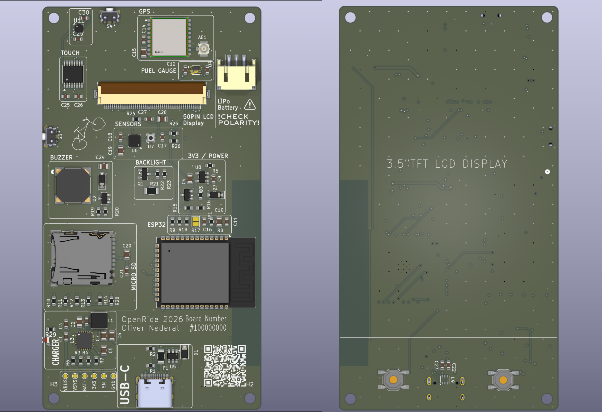
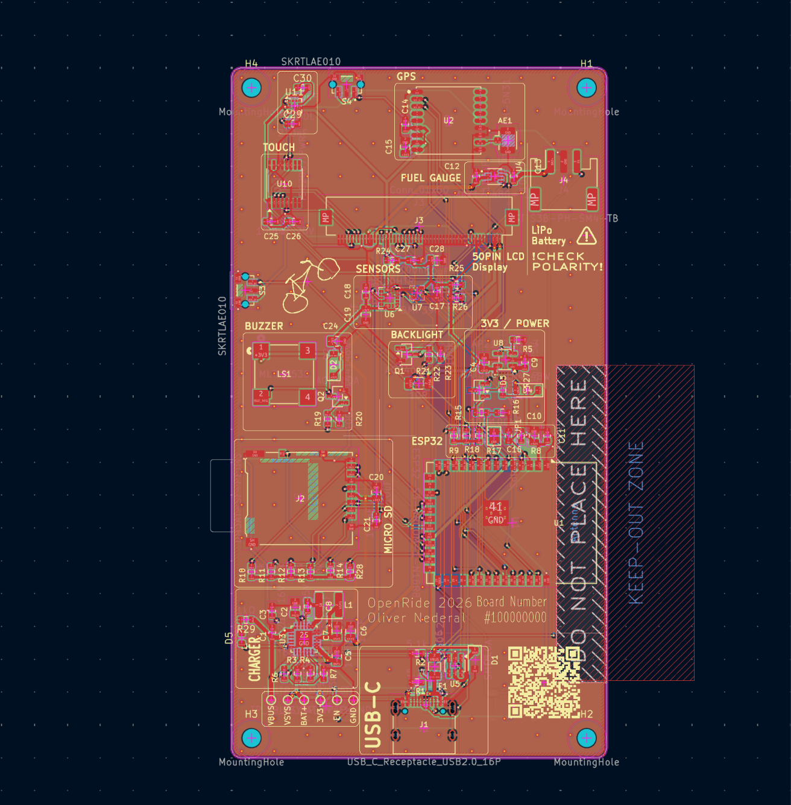
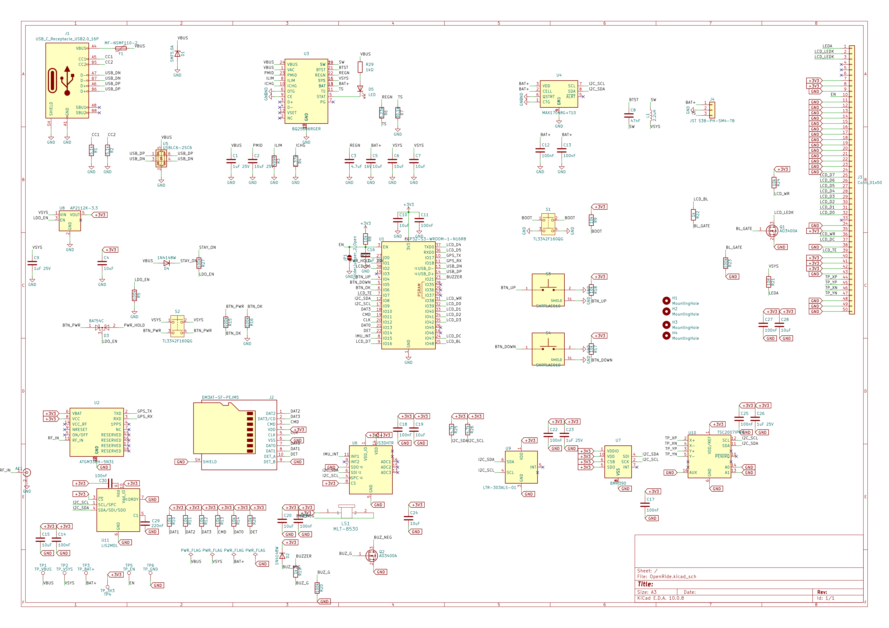

# OpenRide 

A open-source ESP32-based bike computer with GPS tracking and navigation.

## Images

Full 3D assembly
*Coming soon: once enclosure is designed*

PCB 3D Render

PCB

Schematic

Final product
*Coming soon: once finished!*

## Firmware

### https://github.com/oliver-nederal/openride-software (coming soon)

## Features

- Bright resistive 3.2in touchscreen with an auto-brightness sensor
- GNSS positioning (GPS and BeiDou/BDS) precise to 2.5 metres assisted by a built-in compass and barometric altimeter for accurate speed, heading, elevation and gradient calculation.
- MicroSD Card reader for the ability to store offline maps and routes.
- 1S LiPo with switching charger, pass-through power and thermistor-protected charging. Fuel gauge for accurate battery percentage and a charging LED that shows when power is entering the battery.
- 4 firm tactile buttons (2 front, 2 side) which interact with the UI and also as a soft power switch
- USB-C for charging/data/button-free firmware flashing.

## Introduction

Bike computers have been around for half a century now, and for most people who do it as a hobby or a sport. As a prospective cyclist, your main (and only) options are Garmin, Wahoo, and Bryton, which retail for hundreds of dollars and quickly become obsolete when updates end. Moreover, these units are completely glued shut and by design not repairable. As such, I have been motivated to build my own unit which is easily assemblable, fixable, and anyone with a computer can write and update software for.

A lot of inspiration was taken from the bike computers that are on the market right now, and crosses (what in my opinion) is the best of each. 

## Hardware

### Pinout
 
| ESP32-S3 GPIO | Function |
|---|---|
| IO0 | Back button / boot mode |
| IO1 | Power hold (soft power) |
| IO4, IO5 | Up / Down buttons |
| IO6 | Power / OK button |
| IO7 | Display tearing-effect (TE) |
| IO8, IO9 | I2C SDA / SCL (all sensors, touch, fuel gauge) |
| IO10–IO14 | Micro SD (CS, MOSI, CLK, MISO, card detect) |
| IO15 | Accelerometer interrupt |
| IO17, IO18 | GNSS UART (RX, TX) |
| IO19, IO20 | USB D− / D+ |
| IO21 | Buzzer |
| IO38, IO47 | Display WR / DC |
| IO39–IO44, IO2, IO16 | Display data D0–D7 |
| IO48 | Display backlight (PWM) |

## Make it Yourself

The complete list of items required for you is located in the file BOM_consumer.csv

Should you wish to make it yourself, the PCB files are uploaded and the production files are too.  
There are 3 important files:
1. **Open-Ride.zip**: this contains all the Gerber files which tell the PCB manufacturer where to drill, etc...
2. **bom.csv**: Bill-of-Materials containing a list of all the components needed.
3. **positions.csv**:
4. (Optional) **designators.csv**

---

## Contributing
 
Issues/ideas/pull requests are very welcome here, specifically for the hardware.

## License
 
This project is licensed under the MIT License. Please refer to the LICENSE file.
